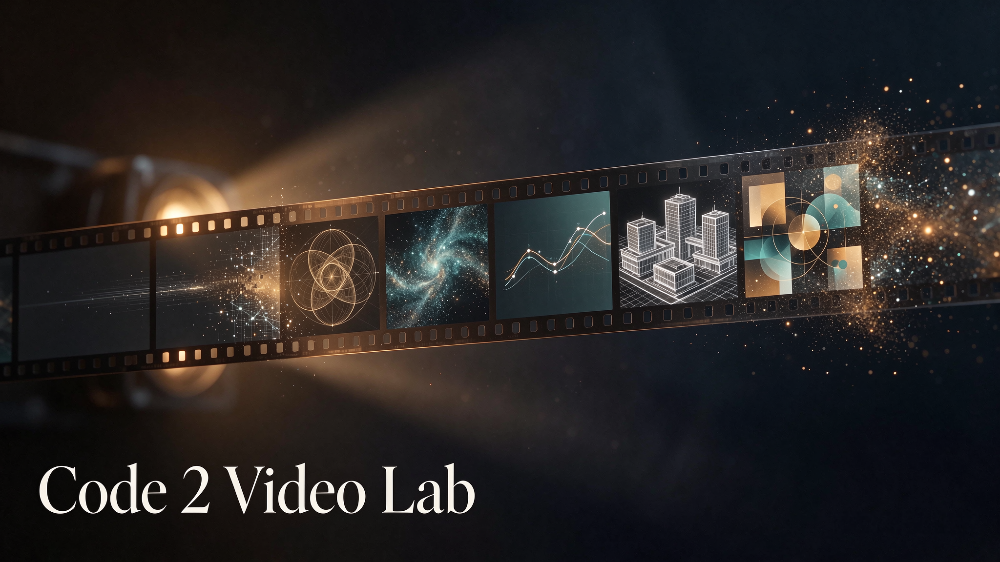
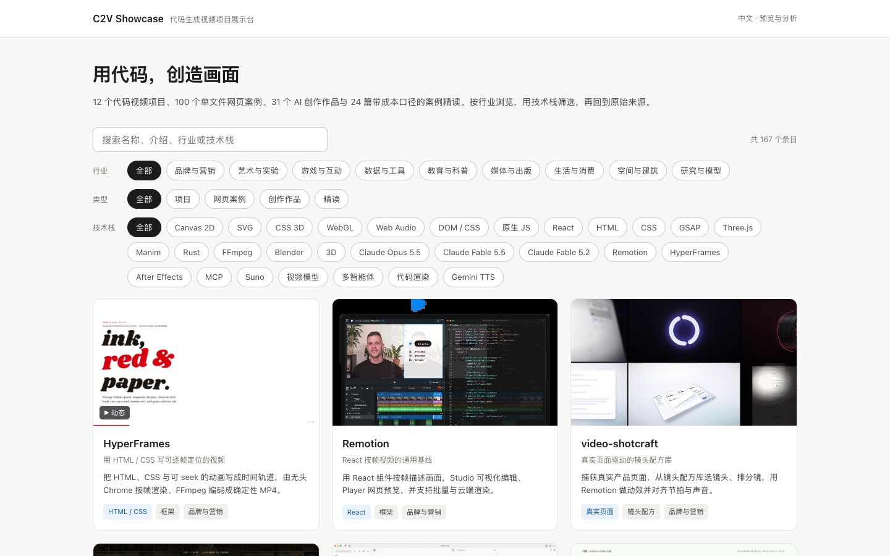
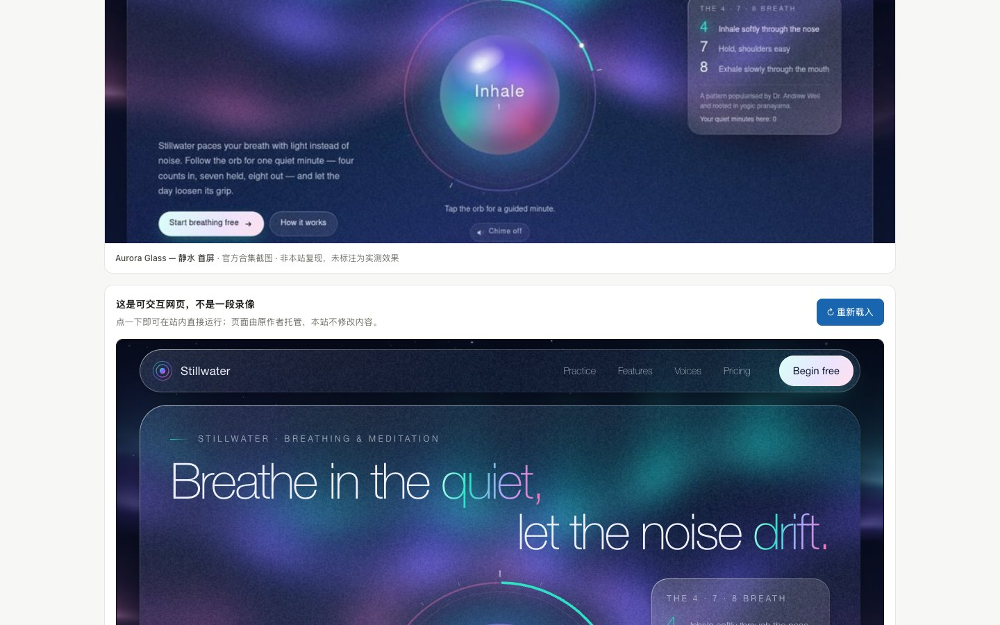

# Code-2-Video-Lab

**A developer-facing showcase for code-generated visuals: 177 entries, 243 real previews, every one traceable back to its source.**

It does not teach you how to write video, and it does not sell you a tool. What it does is gather projects, finished work and cost breakdowns that are scattered across the web, and turn them into a list you can search, filter, and read with one question in mind: *who said this, and was it verified?*

[中文](README.md) | **English**

**Live**: <https://mavcui.github.io/Code-2-Video-Lab/>　|　**Repo**: <https://github.com/MavCui/Code-2-Video-Lab>



---

## Why this exists

Information in this field has two problems: it is **fragmented**, and it is **blended**.

Fragmented, because projects sit scattered across GitHub, X and shared collections — you click a link and find a demo with no finished video. Blended, because claims and evidence tend to live in the same sentence: a README says "one prompt, one video," while the reality may be three hours, tens of dollars, and a lot of manual cherry-picking. One clip gets reposted ten times and its cost number starts to look like a benchmark, until nobody remembers which attempt it came from.

So the trade-off here is simple: **volume is not the goal, traceability is.** Every entry links back to where it came from, and states who made it, what it used, what it cost, and which parts the author never explained.

## Who it is for

- **People choosing a stack.** You want to get on the code-video train but are not sure whether it is Remotion, Manim or HyperFrames — start with the 12 projects, then look at the actual output of similar work. That beats judging by adjectives in a README.
- **People pricing a project.** The 24 case studies keep the author's own accounting of cost and duration, **including the parts they left unclear**: whether retries were counted, what was being priced, where the clock started.
- **People already building.** The 100 web cases are not recordings — they run in place, so you can see how far someone pushed pure code.

## What's inside

Five content types, three jobs: **tools that run**, **work that shipped**, **breakdowns that do the math**.

| Type | Count | What it is | Badge |
|---|---|---|---|
| Projects | 12 | Open-source code-video tools and frameworks (HyperFrames, Remotion, OpenFilm, fframes, …) | none |
| Web cases | 100 | Single-file HTML pages, showing how far code alone can push visuals | 案例 |
| AI works | 31 | AI-made videos with author-disclosed production details and comparison demos | 作品 |
| Case studies | 24 | Deep reads with cost, duration and token accounting, including evidence gaps | 精读 |
| Production cases | 10 | Shipped work from companies: HeyGen, Digital Samba, Sublevel, GitHub Unwrapped and more | 落地 |

**177 entries, 243 preview assets**, of which **59 are auto-playing clips**.

**Nine industries** form the primary classification: art & experiment 54, brand & marketing 28, games & interaction 22, education 19, data & tools 19, media & publishing 15, space & architecture 11, life & consumer 7, research & models 2. The numbers add up to 177 — no entry sits outside a category.

**Tech stack is a separate tag dimension**: Canvas 2D, SVG, WebGL, Three.js, Remotion, HyperFrames, Blender, Manim, MCP, After Effects, plus Claude Opus 5.5 / Fable 5.5 / Fable 5.2.

**Type is its own filter**: projects / web cases / AI works / case studies / production cases. Want only the ones that show a bill? 精读 gives you 24. Want company-delivered work? 落地案例. The selection report sits apart in the header (选型报告) and stays out of the card list — it is a conclusion, not an entry.

## Three ways in

**Browse by industry.** The home page is hand-curated, not sorted by stars or IDs. Cards carry a preview, a title, one line and tags; click through for detail.

**Search by question.** Wondering what a model swap actually costs? Filter to Opus / Fable and open a case study. The cost table keeps the author's own accounting intact — currency, whether retries were included, whether start and end points were even defined — with no conversion, no cross-case division, no ranking.

**Just run it.** The web cases are not screen recordings; they are interactive pages. On a detail page, "▶ 在站内运行" loads the author's hosted page inside a sandboxed iframe, so you can scroll, click and play. Third-party content is labeled as such.



## Editorial rules

The site constrains what it may claim, and those constraints live in the data and the build gate — not in good intentions:

- **No implied testing.** Projects that were never run are labeled "未运行代码、未复现样片" (code not run, sample not reproduced). Cases we never operated by hand say "未逐页运行交互".
- **Author claims and our judgment stay separate.** Cost, duration, token counts and call counts always carry their source type (author-stated / machine-recorded / third-party measured). Our own judgment appears only in explicitly labeled sections such as "可复用点与适用边界" — what transfers, and where it stops.
- **Evidence gaps are written down.** If the author never said whether retries were included, how input and output were priced, or where the clock started, the page says "未说明" (not stated) instead of filling it in.
- **Code license is not media license.** "Code license" and "basis for using the preview media" are separate field groups, and the validator rejects any wording that derives media permission from the code license. When a collection has no LICENSE, it says so.
- **No rankings.** Task complexity, runtime and pricing basis differ; cost numbers are never divided across cases or turned into a leaderboard.
- **Dead links stay visible.** One case study's original post now returns 404; the button and the notice both say the post is currently unreachable.

## Build gate

The site is built with Astro and content lives in Markdown frontmatter. `npm run check` runs a full pass before every build, and it **blocks** rather than warns:

| Check | Behavior |
|---|---|
| Required fields, unique slugs, industry and tech tags within vocabulary | **Blocks**, exit code 1 |
| Cover / thumbnail / motion preview files exist and are non-empty | **Blocks** |
| First media record matches the cover; every motion clip has its own source record | **Blocks** |
| Analysis length, related entries resolve, no affirmative "we tested it" wording | **Blocks** |
| Third-party link reachability | **Never blocks**; written to `reports/外链人工复核.md`, split into confirmed failures vs. undeterminable from this network |

`npm run build` runs the check first, so any blocking issue fails the build. An entry whose sourcing cannot be written down cannot be published either.

## Stack

- **Astro 5** + Content Collections (Zod schemas) + plain CSS. Fully static, no frontend framework.
- One collection per content type: `projects` / `cases` / `works` / `studies` / `practice`.
- Filtering and search are inline scripts generated at build time; state lives in the URL, and returning from a detail page restores filters and scroll position.
- Motion previews are 5-second silent MP4 loops (H.264, 640px wide): autoplay on detail pages, hover-to-play on cards, never loaded on mobile.

## Run locally

```bash
npm install
npm run dev        # http://localhost:4321
npm run check      # pre-publish validation (includes link probing)
npm run build      # validate + build into dist/
npm run preview    # preview the build output
```

Skip link probing on an offline machine:

```bash
SKIP_LINK_PROBE=1 npm run build
```

## Layout

```
src/
  content/
    projects/    12 projects (+1 draft)
    cases/       100 single-file web cases
    works/       31 AI-made works
    studies/     24 case studies
    practice/    10 company production cases
  pages/         showcase, five detail templates, about
  components/    shared card
  data/          taxonomy.json — industries, tech tags, types
  styles/        global.css
public/media/    243 preview assets (stills + preview.mp4)
public/decision-report/  Standalone selection report HTML (isolated from the case cards)
scripts/         validate.mjs (gate), build.mjs (build wrapper)
docs/            release checklist, page acceptance list, sourcing notes, media registry
data/            internal verification ledger (not used by the site)
```

## Deploy

The repo root is the Astro project. Two routes, both verified.

**GitHub Pages (the current live site)**

Project sites are served under `<user>.github.io/<repo>/`, so root-absolute paths need a prefix. One command handles build, rewrite and push:

```bash
npm run deploy:gh
```

It is equivalent to `BASE_PATH=/Code-2-Video-Lab npm run build` → `node scripts/prefix-base.mjs` → push `dist/` to the `gh-pages` branch.

**Vercel (served at the root, no prefix)**

```bash
npx vercel --prod
```

Or import the repo and pick the Astro preset — `vercel.json` already sets `buildCommand: npm run build:ci` (skips link probing) and `outputDirectory: dist`. Do not set `BASE_PATH` for a root deployment.

## Adding an entry

1. Confirm **preview and sourcing** first: is there a real image that matches? Can the media usage basis be stated on its own?
2. Create a `.md` in the right collection and fill in the frontmatter defined by `src/content.config.ts`.
3. Write the content: four questions for a project, summary and technical notes for a case, production details and limits for a work, pipeline breakdown and cost basis for a study.
4. Once `npm run check` passes, flip `status` from `draft` to `published`.

That workflow is itself the filter: if you cannot get a real preview or explain where it came from, the entry does not get in.

## Known limitations

- **Chinese first.** The UI and all entries are in Chinese; English exists in this README and `docs/INTRO.en.md`.
- **No automation.** No crawler, no scheduled job. Content is maintained by hand; the last pass was 2026-11-16.
- **Previews are citations, not reproductions.** Every frame comes from the original author or official assets. No pipeline here has ever been run by us.
- **Media permissions are pending.** The 243 assets are registered as introductory citation with attribution and a backlink; public commercial redistribution needs per-item confirmation from rights holders.
- **One dead link.** The original post for case study #12 is gone (404), and the page says so.

## License and credits

- **Site code**: MIT, see [LICENSE](LICENSE).
- **Editorial content**: written and edited here; copyright remains with the site.
- **Preview media**: copyright belongs to the original authors. Used as introductory citation with attribution. **The LICENSE does not cover any preview asset.**
- Thanks to every author and creator included here. This site only tries to make what they already published a little easier to read.

## More documents

- [项目介绍（中文）](docs/INTRO.md) · [Introduction (EN)](docs/INTRO.en.md)
- [Release checklist](docs/发布检查表.md) · [Page acceptance list](docs/页面验收清单.md)
- [Media and license registry](docs/媒体与许可登记.md)
- [Selection and taxonomy notes](docs/首批项目选择说明.md) · [Case study notes](docs/精读说明.md)
