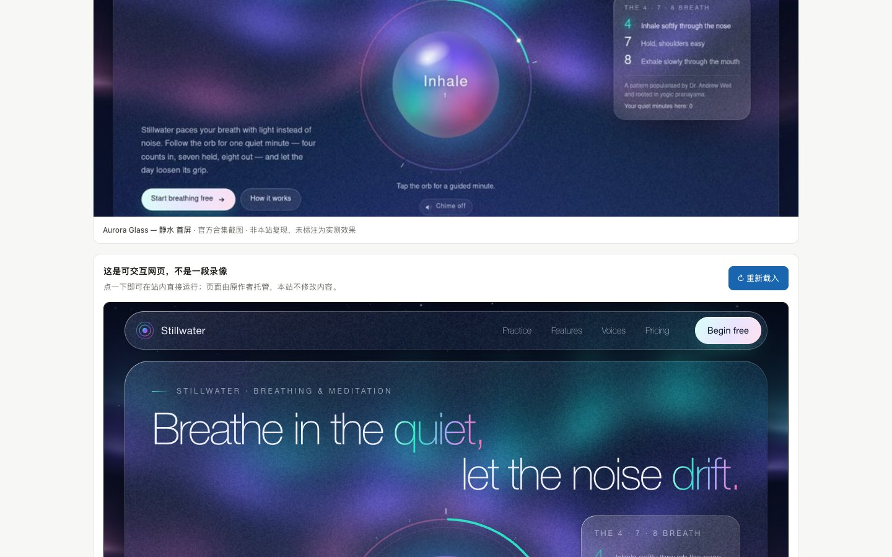

# Code-2-Video-Lab

> 一个关于「代码生成画面」的开发展厅：167 个条目、231 个真实预览素材，都能回到原始来源。

**中文** | [English](README.en.md)


---

## 这是什么

Code-2-Video-Lab 收集并整理「用代码生成视频／画面」这件事上的三类东西：能跑的工具与框架、真实做出来的作品、以及能算账的案例拆解。

它不是一个视频生成产品，也不做模型调用。它是一个**内容站**：把散落在 GitHub、X、飞书合集里的项目与案例，按统一口径整理成可浏览、可筛选、可回溯的条目，每一条都能点回原始来源。

做这件事的原因是：这个领域的信息极度碎片化，而且**宣称与证据混在一起**。README 说「一句话生成视频」，实际可能是 3 小时、几十美元、外加大量人工挑片；同一条片子被转发十次，成本数字越传越像基准。所以这个站的核心不是「收录得多」，而是**每条信息都能说清楚它从哪来、是谁说的、有没有被验证**。

## 展厅里有什么

| 类型 | 数量 | 是什么 | 角标 |
|---|---|---|---|
| 项目 | 12 | 开源的代码视频工具与框架（HyperFrames、Remotion、OpenFilm、fframes 等） | 无 |
| 网页案例 | 100 | 单文件 HTML 生成的可交互页面，展示代码直接产出视觉的边界 | 案例 |
| 创作作品 | 31 | 用 AI 做出来的视频作品，含作者披露的制作细节与对比 Demo | 作品 |
| 案例精读 | 24 | 带成本、时长、token 口径的深度拆解，含证据缺口 | 精读 |

合计 **167 个条目、231 个预览素材**，其中 **57 段**是会自动播放的原片片段。

**9 个行业做一级分类**：品牌与营销、艺术与实验、游戏与互动、数据与工具、教育与科普、媒体与出版、生活与消费、空间与建筑、研究与模型。
**技术栈是独立标签**：Canvas 2D、SVG、WebGL、Three.js、Remotion、HyperFrames、Blender、Manim、MCP、After Effects，以及 Claude Opus 5.5 / Fable 5.5 / Fable 5.2 等。
**类型可单独筛选**：只想看能算账的案例，点「精读」就是 24 条。

## 三种看法

**一、按行业逛。** 首页默认按人工精选排序，卡片给预览、标题、一句话和标签。看到感兴趣的进详情。

**二、按问题找。** 想知道「同题换模型到底差多少钱」，用搜索或技术栈筛到 Opus / Fable，再进精读页看成本对照表——表里原样保留作者口径（币种、是否含重试、起止点是否定义），不换算、不相除、不排名。

**三、直接看它跑。** 100 个网页案例不是录像，是能交互的页面。详情页点「▶ 在站内运行」，会在沙箱 iframe 里加载原作者托管的页面，可以直接滚动、点击、玩。第三方内容有明确标注。



## 内容口径

这个站对「说什么」有硬约束，写在数据和门禁里，不靠自觉：

- **不写实测。** 没有运行过的项目一律标注「未运行代码、未复现样片」；没有逐页操作过的案例标注「未逐页运行交互」。
- **作者自述与本站判断分开。** 成本、时长、token、调用次数全部标明来源类型（作者自述 / 机器记录 / 第三方实测），本站判断只出现在「可复用点与适用边界」这类明确署名的段落。
- **证据缺口照实写。** 作者没说清楚的（是否含重试、输入输出如何计价、起止点定义），统一写「未说明」，不用推测补齐。
- **代码许可 ≠ 媒体许可。** 每个条目的「代码许可」和「预览媒体使用依据」是两组独立字段，脚本会拒绝「由代码许可推导媒体权限」的表述。合集没有 LICENSE 时就写「未取得独立 LICENSE 文件」，不假装有。
- **不做排名。** 不同任务复杂度、成片时长、计价口径不同，成本数字不可跨案例相除或排名。
- **原帖失效就照实标。** 有一条案例的原帖已 404，页面上按钮和提示条都写「原帖当前不可访问」，不隐藏。

## 质量门禁

站点用 Astro 构建，内容放在 Markdown 的 frontmatter 里。`npm run check` 在构建前跑一遍全量校验：

| 检查 | 行为 |
|---|---|
| 必填字段、slug 唯一、行业与技术栈在词表内 | **阻断**，退出码 1 |
| 封面/缩略图/动态预览文件存在且非空 | **阻断** |
| 首条媒体登记与封面一致、每段动态预览都有独立来源登记 | **阻断** |
| 分析正文长度、相关条目存在、无肯定式实测措辞 | **阻断** |
| 第三方外链可达性 | **不阻断**，写入 `reports/外链人工复核.md`，区分「确认异常」与「本环境无法判定」 |

`npm run build` 会先跑校验再构建，任何阻断项都会让构建失败。

## 技术栈

- **Astro 5** + Content Collections（Zod schema）+ 原生 CSS，纯静态输出，零前端框架。
- 四类内容各一个集合：`projects` / `cases` / `works` / `studies`。
- 筛选与搜索是构建期生成的内联脚本，状态写进 URL，返回列表时恢复筛选与滚动位置。
- 动态预览是 5 秒静音循环的 MP4（H.264，640 宽），详情页自动播放，卡片桌面悬停播放，手机不加载。

## 本地运行

```bash
npm install
npm run dev        # http://localhost:4321
npm run check      # 发布前校验（含外链探测）
npm run build      # 校验 + 构建，输出到 dist/
npm run preview    # 预览构建产物
```

离线环境可跳过外链探测：

```bash
SKIP_LINK_PROBE=1 npm run build
```

## 目录结构

```
src/
  content/
    projects/    12 个项目（+1 个 draft）
    cases/       100 个单文件网页案例
    works/       31 个 AI 创作作品
    studies/     24 篇案例精读
  pages/         展厅、四类详情页、关于页
  components/    统一卡片
  data/          taxonomy.json：行业词表、技术栈词表、类型
  styles/        global.css
public/media/    231 个预览素材（静帧 + preview.mp4）
scripts/         validate.mjs（门禁）、build.mjs（构建包装）
docs/            发布检查表、页面验收清单、来源说明、媒体登记
data/            核验条目底表（内部溯源，不参与页面逻辑）
```

## 部署

仓库根目录就是 Astro 项目，Vercel 可直接识别：

```bash
npx vercel --prod
```

或在 Vercel 导入仓库，Framework Preset 选 Astro，Build Command 用默认即可（`npm run build`）。

## 新增一个条目

1. 先确认**预览素材与来源**：有没有能对上的真实画面？媒体使用依据能不能单独写清楚？
2. 在对应集合新建 `.md`，按 `src/content.config.ts` 的字段填 frontmatter。
3. 写内容：项目写四问分析，案例写说明与技术要点，作品写制作细节与边界，精读写链路拆解与成本口径。
4. `npm run check` 通过后，再把 `status` 从 `draft` 改为 `published`。

这条流程本身就是筛选器：拿不到真实预览、说不清来源的条目，进不来。

## 已知限制

- **中文优先。** 站点界面与内容为中文；英文只有本 README 与 `docs/INTRO.en.md`。
- **不自动更新。** 没有爬虫、没有定时任务，内容靠人工维护，最后一次整理是 2026-11-16。
- **预览是引用，不是复现。** 所有画面来自原作者或官方素材，本站没有跑过任何一条 pipeline。
- **素材授权待确认。** 231 个素材目前登记为「介绍性引用、已署名回链」，公开商用分发前需逐条向权利方确认。
- **一条死链。** 精读第 12 篇的原帖已 404，页面上已标注。

## 许可与致谢

- **站点代码**：MIT（见 [LICENSE](LICENSE)）。
- **收录内容**：文字分析为本站整理，版权归本站；项目介绍与案例描述基于官方 README、作者原帖与公开合集，已在每条详情页署名回链。
- **预览素材**：版权归原作者，本站仅作介绍性引用，**LICENSE 不覆盖任何预览素材**。
- 感谢所有被收录项目的作者与创作者。这个站只是把他们已经公开的东西整理得更容易看懂。

## 相关文档

- [项目介绍（中文）](docs/INTRO.md) · [Introduction (EN)](docs/INTRO.en.md)
- [发布检查表](docs/发布检查表.md) · [页面验收清单](docs/页面验收清单.md)
- [媒体与许可登记](docs/媒体与许可登记.md)
- [收录与分类说明](docs/首批项目选择说明.md) · [精读说明](docs/精读说明.md)
